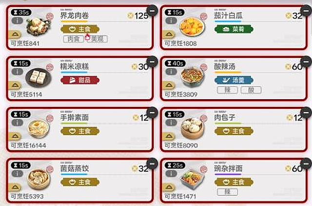

# 咕嘎餐馆 V2.1

**中文** | [English](README_EN.md)

缘缘庄「食有老饕」全自动经营。开局站到吧台旁点一下「开始挂机」，之后接待老饕、读点单、做菜、上菜送饮品、开满堂彩、结算、走回吧台开下一局，全程不用碰键盘鼠标，可以一直循环跑。


- 作者：ReDocTing
- 许可证：MIT（见 [LICENSE](LICENSE)）
- 实测（正式经营，作者开发环境）：连续 12 局平均营业额 5690（最低 5437），12 局全部送齐 15 桌，0 次走丢
- 使用演示视频：[B 站 BV1HoWT6DEAS](https://www.bilibili.com/video/BV1HoWT6DEAS/)

## 下载使用（不用装 Python）

到 **[Releases](../../releases/latest)** 下载 `GugaRestaurant_V2.1.zip`（用户版，约 200MB），解压到任意文件夹，双击里面的 `咕嘎餐馆.exe`。

1. Windows 10 / 11。游戏设成 **窗口化**、分辨率 **1920×1080**，游戏窗口不要被挡住，挂机时别动鼠标键盘。
2. 主题选「食有老饕」，菜单和厨房按下面的[游戏内设置](#游戏内设置菜单和厨房)配好。
3. 人物站到缘缘庄吧台「开始经营」提示旁，视角面朝吧台。
4. 打开程序（要管理员权限，弹窗点「是」），选局数和模式，点「开始挂机」。正式经营每局会消耗客源（约 60）。
5. **紧急停止**：键盘 `~` 键（Tab 上面），或点「停止」。
6. 每局结果自动记进程序旁边的 `对局记录.csv`，Excel 能直接打开。

> 解压后整个文件夹要放在一起：`picture_laotao`、`menu`、`test_channel` 是识别用的图片和数据，别删、别改名。
>
> exe 没有数字签名，Windows 提示「已保护你的电脑」时点「更多信息」→「仍要运行」；部分杀毒软件会误报（Python 打包 + 模拟按键），加信任即可。

## 游戏内设置（菜单和厨房）

程序是按作者这套设置做的，换了可能识别不准、点错。

### 菜单：8 道菜 + 6 种饮品



**菜（按这个顺序）**：界龙肉卷、茄汁白瓜、糯米凉糕、酸辣汤、手擀素面、肉包子、菌菇蒸饺、豌杂拌面

> ⚠️ **这 8 道菜和顺序都不能改。** 整套菜单是对照各位老饕的点单要求筛选出来的，程序的点单匹配就是按这套菜单写的，换掉任何一道都可能让老饕点的菜对不上、断连。

- **界龙肉卷**是主力菜：程序只做这一道（料理界面里认它的卡片）。
- **糯米凉糕**：开局先做一份放在吧台第一格，当定位原点，整局不拿。

**饮品（按这个顺序）**：瓶装霞莓饮（果香）、潮前龙井（茶香）、梨花香茶、大碗碎茶、瓶装脆蔗汁、玉米汁


- **霞莓饮第一个、潮前龙井第二个**不能换：程序在饮品台面板里按固定位置点（左上是果香、右上是茶香）。

### 厨房


| 厨房 | 干员 |
|---|---|
| 厨房一 | 大厨狼卫、大厨别礼 |
| 厨房二 | 大厨莱万汀、大厨秋栗 |
| 厨房三 | 大厨余烬、大厨卡缪 |

- 协助职责：一名带「结账 / 上饮品 / 上菜」的干员；品质把控（所有厨房珍馐产出概率 +8%）。
- 厨房干员影响做菜速度和珍馐概率。干员不一样也能跑，营业额会有差别；但每个厨房**至少安排 1 名干员**，否则开不了局。

## V2.1 更新

- 取菜更快：拿 1 份约 3.1 → 2.0 秒，2 份约 4.8 → 2.3 秒
- 上菜更快：同一桌连送两样的间隔约 1.1 → 0.5 秒
- 按停止后立刻放开所有按键和鼠标键
- 从出餐台直接出发时，离饮品台太远先回饮品台重新定位，减少走偏
- 修正「送齐桌数」统计
- 不再被 Windows 降速：程序窗口在游戏后面时，Windows 11 会把它放进「效率模式」，识别慢好几倍；现在启动时声明不节能、优先级调高（只改本程序，不改系统设置）
- 满堂彩后回饮品台保持手上 1 茶 1 果；读到要求的桌先按要求拿
- 满堂彩结束后，没有等菜的桌、只有新客人正在来时，手上有一菜一饮就直接过去等，不先回去补货
- 正式经营客源不足（每局约 60）时自动停下并提示，不再来回重试

## 从源码运行

需要 Windows 10 / 11、Python 3.9（作者用 3.9.13）。

```bat
python -m venv venv
venv\Scripts\pip install -r requirements.txt
```

以**管理员身份**打开命令行，进入本文件夹：

```bat
venv\Scripts\python guga_app.py
```

## 打包成 exe

```bat
venv\Scripts\python build.py
```

生成 `dist\咕嘎餐馆_V2.1\`（exe + 运行要用的图片和数据），整个文件夹压缩就能发给别人。

## 文件说明

| 文件 / 文件夹 | 作用 |
|---|---|
| `guga_app.py` | 给使用者的界面（tkinter）：开始/停止、餐桌实时状态、最近对局、统计 |
| `laotao_bot.py` | 核心逻辑：截屏识别、寻路、接待、读点单、做菜、上菜、满堂彩、结算。直接运行是带调试面板的开发界面 |
| `hall_locator.py` | 按画面认出自己在大厅哪里（ORB 特征匹配 `test_channel/survey` 里的参考图） |
| `record_file.py` | `对局记录.csv` 的读写；被 Excel / WPS 改过存过、编码和格式变了也能读、能接着写 |
| `laotao_config.json` | 所有参数（走路时长、等待时间、饮品数量等） |
| `picture_laotao/` | 识别用的模板图（F 提示、界面按钮、菜品图标等）和界面头像 |
| `menu/` | 菜单和老饕点单规则 |
| `test_channel/nodes`、`survey`、`places_clean` | 寻路和定位用的参考画面 |
| `test_channel/wang_params.json` | 寻路时自动学到的参数 |
| `build.py` | 打包用户版 |

## 大致原理

- **识别**：OpenCV 模板匹配认 F 提示、界面元素、菜品图标；RapidOCR 读老饕气泡里的点单文字。
- **定位**：饮品台是唯一原点（F 提示 +「饮」字确认）。回饮品台时先往吧台走到顶住，再贴着吧台滑，提示一出现就停。
- **寻路**：饮品台 → 中间过道口 → 沿过道到那一排 → 横走到桌边（「王」字形路线）。每到一个节点用地面斜线的**消失点**摆正视角（转镜头时消失点会移动，人站偏了它不动）；到桌边按**桌号牌**在画面里的位置靠到标准站位，并用看到的其他桌号牌确认没走错、没走过头。每趟实际走的时长会少量掺进学到的参数。
- **朝向兜底**：按 F 后镜头偶尔被带歪或转反，出发前和「面朝吧台」样本比，对不上就转四个方向找回来。回不到饮品台就判走丢，结束这一局开下一局。
- **经营**：按老饕身份和点单匹配菜和饮品（茶香 / 果香），读不清的饮品先不送；吧台菜不够时开料理界面补菜；送齐 8 桌攒满后补满厨房再开满堂彩；读打烊倒计时安排收尾，尽量不留没送完的桌。

## 常用调试参数（`laotao_config.json`）

| 参数 | 说明 |
|---|---|
| `business_mode` | `试营业` / `正式经营` |
| `debug_files` | `true` 时出问题会存截图到 `test_channel/` |
| `trace` | `true` 时关键节点截图存到 `test_channel/trace/` |
| `save_places` | `true` 时到饮品台、到桌边存画面，攒定位数据 |
| `avoid_cpus` | 让游戏和程序避开某几个 CPU 核心，例如 `[10, 11]`；默认 `[]` 不限制 |
| `skip_laotao` | 这几号老饕的点单界龙肉卷满足不了时先不送 |

直接运行 `python laotao_bot.py` 会打开开发界面：可以手动走位、单独测试某个动作、改参数。

## 说明

- `laotao_bot.py` 里有可选的 MaaEnd 回吧台功能（`use_maaend`），本仓库**不包含** MaaEnd，默认关闭，不影响使用。
- 识别用的游戏截图、图标版权归游戏开发商所有，仅用于识别。
- 仅供学习交流，使用风险自负。
