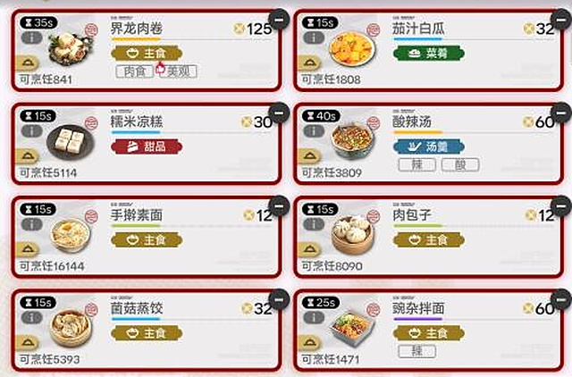
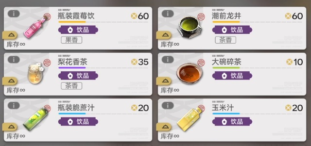
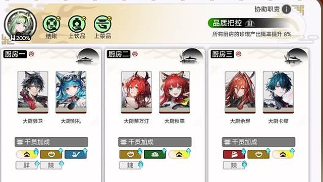

# Guga Restaurant V2.1

[中文](README.md) | **English**

A fully automatic helper for the "食有老饕" (Gourmet Guests) restaurant activity at 缘缘庄 in Arknights: Endfield. Stand next to the counter, click **Start**, and it takes over: receiving gourmet guests, reading their orders, cooking, serving dishes and drinks, triggering the full-house bonus (满堂彩), settling the round, and walking back to the counter for the next one. No keyboard or mouse input needed, and it can loop indefinitely.


- Author: ReDocTing
- License: MIT (see [LICENSE](LICENSE))
- Measured (正式经营 / regular business mode): 16 rounds in a row averaged 5615 revenue (lowest 5123), never got lost, and most rounds served all 15 tables
- Demo video: [Bilibili BV1HoWT6DEAS](https://www.bilibili.com/video/BV1HoWT6DEAS/)

> The game UI is in Chinese, and so are the program's interface, logs and most code comments.

## Download & use (no Python needed)

Download `GugaRestaurant_V2.1.zip` (user build, about 200MB) from **[Releases](../../releases/latest)**, unzip it anywhere, and double-click `咕嘎餐馆.exe`.

1. Windows 10 / 11. Run the game in **windowed mode at 1920×1080**. Keep the game window uncovered and don't touch the mouse or keyboard while it runs (it works by reading the screen).
2. Pick the 「食有老饕」 theme, and set up the menu and kitchen as described in [In-game setup](#in-game-setup-menu-and-kitchen) below.
3. Stand next to the 「开始经营」 (Start business) prompt at the 缘缘庄 counter, facing the counter.
4. Start the program (it needs administrator rights because the game runs as administrator; click "Yes"), pick the number of rounds and the mode, then click 「开始挂机」 (Start). Regular business mode (正式经营) uses up about 60 customer supply per round.
5. **Emergency stop**: press the `~` key (above Tab), or click 「停止」 (Stop).
6. Each round's result is appended to `对局记录.csv` next to the program, which opens directly in Excel.

> Keep the unzipped folder together: `picture_laotao`, `menu` and `test_channel` hold the images and data used for recognition. Don't delete or rename them.
>
> The exe isn't code-signed. If Windows shows "Windows protected your PC", click "More info" → "Run anyway". Some antivirus software may flag it (a Python-packaged program that simulates key presses); add an exception if so.

## In-game setup (menu and kitchen)

The program was built around the author's setup. With a different one it may misrecognize things or click the wrong item.

### Menu: 8 dishes + 6 drinks



**Dishes (in this order)**: 界龙肉卷, 茄汁白瓜, 糯米凉糕, 酸辣汤, 手擀素面, 肉包子, 菌菇蒸饺, 豌杂拌面

> ⚠️ **Don't change any of these 8 dishes or their order.** The whole menu was picked by checking it against each gourmet guest's order requirements, and the program's order matching is written for exactly this menu. Swapping any dish can make guests' orders impossible to satisfy and break the serving streak.

- **界龙肉卷** is the main dish: it's the only one the program cooks (it finds this dish's card in the cooking screen).
- **糯米凉糕**: one portion is cooked at the start and left in the first slot of the counter as the positioning origin; it's never picked up.

**Drinks (in this order)**: 瓶装霞莓饮 (fruit-scented / 果香), 潮前龙井 (tea-scented / 茶香), 梨花香茶, 大碗碎茶, 瓶装脆蔗汁, 玉米汁



- **霞莓饮 must be first and 潮前龙井 second**: the program clicks fixed positions in the drink station panel (top-left = fruit-scented, top-right = tea-scented).

### Kitchen



| Kitchen | Operators |
|---|---|
| 厨房一 (Kitchen 1) | 大厨狼卫, 大厨别礼 |
| 厨房二 (Kitchen 2) | 大厨莱万汀, 大厨秋栗 |
| 厨房三 (Kitchen 3) | 大厨余烬, 大厨卡缪 |

- Assist role (协助职责): an operator with 结账 (checkout) / 上饮品 (serve drinks) / 上菜 (serve dishes); quality control (品质把控) gives +8% chance of premium dishes (珍馐) in all kitchens.
- Kitchen operators affect cooking speed and the premium-dish chance. Other operators work too, with different revenue; but every kitchen needs **at least one operator** or the round can't start.

## What's new in V2.1

- Faster dish pickup: about 3.1 → 2.0 s for one dish, 4.8 → 2.3 s for two
- Faster serving: the gap between two items for the same table dropped from about 1.1 s to 0.5 s
- Stopping now immediately releases every key and mouse button
- When heading out straight from the serving counter, it first returns to the drink station if it's too far away, which reduces wrong turns
- Fixed the "tables fully served" count

## Run from source

Requires Windows 10 / 11 and Python 3.9 (tested with 3.9.13).

```bat
python -m venv venv
venv\Scripts\pip install -r requirements.txt
```

Open a command prompt **as administrator** in this folder:

```bat
venv\Scripts\python guga_app.py
```

## Build the exe

```bat
venv\Scripts\python build.py
```

This creates `dist\咕嘎餐馆_V2.1\` (the exe plus the images and data it needs). Zip the whole folder to share it.

## Files

| File / folder | Purpose |
|---|---|
| `guga_app.py` | User interface (tkinter): start/stop, live table status, recent rounds, statistics |
| `laotao_bot.py` | Core logic: screen recognition, navigation, receiving guests, reading orders, cooking, serving, full-house bonus, settlement. Running it directly opens a developer UI with debug controls |
| `hall_locator.py` | Works out where you are in the hall from the picture (ORB feature matching against reference images in `test_channel/survey`) |
| `record_file.py` | Reads and writes `对局记录.csv`; still works after the file has been edited and re-saved in Excel / WPS with a different encoding or format |
| `laotao_config.json` | All parameters (walk durations, wait times, number of drinks, etc.) |
| `picture_laotao/` | Template images for recognition (F prompts, UI buttons, dish icons, etc.) and the UI avatar |
| `menu/` | Menu and gourmet-guest order rules |
| `test_channel/nodes`, `survey`, `places_clean` | Reference images for navigation and positioning |
| `test_channel/wang_params.json` | Parameters learned automatically while walking |
| `build.py` | Builds the user version |

## How it works

- **Recognition**: OpenCV template matching finds F prompts, UI elements and dish icons; RapidOCR reads the order text in the guests' speech bubbles.
- **Positioning**: the drink station is the single origin (confirmed by its F prompt plus OCR reading 「饮」). To get back to it, the character walks into the counter until blocked, then slides along the counter until the prompt appears.
- **Navigation**: drink station → middle aisle → along the aisle to the right row → sideways to the table (a fixed 「王」-shaped route). At each node the camera is straightened using the **vanishing point** of the floor lines (it moves when the camera turns, but not when the character is merely off to one side). At the table, the character uses the position of the **table number sign** on screen to reach a standard standing spot, and checks the other visible signs to confirm it isn't at the wrong table or past it. Each trip's actual walk times are blended slightly into the learned parameters.
- **Orientation fallback**: pressing F sometimes swings the camera off or even turns it around. Before setting out, it compares the view with "facing the counter" samples and, if they don't match, tries all four directions to recover. If it can't get back to the drink station, the round is treated as lost: it ends that round and starts the next.
- **Business logic**: dishes and drinks (tea-scented / fruit-scented) are matched to each gourmet guest's identity and order, and a drink whose request couldn't be read is held back rather than guessed. It cooks more when the counter runs low; after fully serving 8 tables it refills the kitchen before triggering the full-house bonus; and it reads the closing countdown to plan the end of the round so no received guest is left unserved.

## Useful debug settings (`laotao_config.json`)

| Key | Meaning |
|---|---|
| `business_mode` | `试营业` (trial) / `正式经营` (regular) |
| `debug_files` | When `true`, saves screenshots to `test_channel/` when something goes wrong |
| `trace` | When `true`, saves screenshots at key points to `test_channel/trace/` |
| `save_places` | When `true`, saves frames at the drink station and tables to collect positioning data |
| `avoid_cpus` | Keeps the game and this program off specific CPU cores, e.g. `[10, 11]`; default `[]` means no restriction |
| `skip_laotao` | Gourmet guests (by number) whose order 界龙肉卷 can't satisfy are held back |

Running `python laotao_bot.py` directly opens the developer UI, where you can move manually, test individual actions and tweak parameters.

## Notes

- `laotao_bot.py` contains an optional MaaEnd-based "return to counter" feature (`use_maaend`). MaaEnd is **not included** in this repository; the feature is off by default and isn't needed.
- Game screenshots and icons used for recognition are copyrighted by the game's developer and are used only for recognition.
- For learning and personal use only. Use at your own risk.
